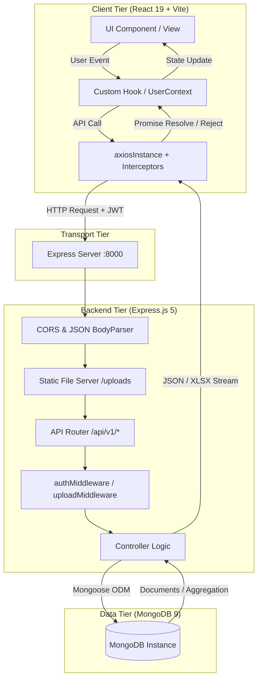
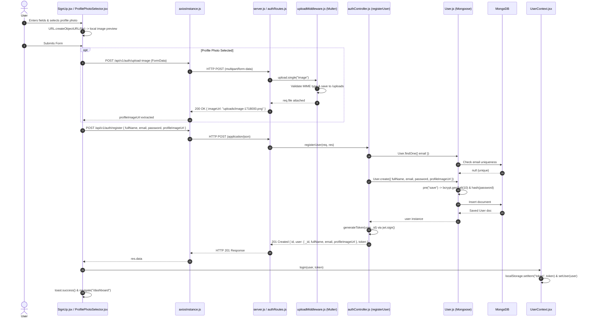
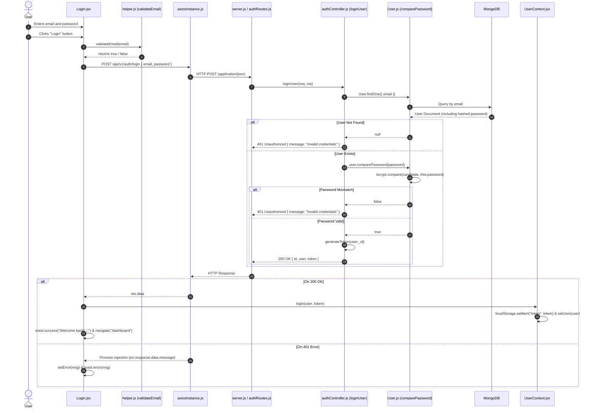
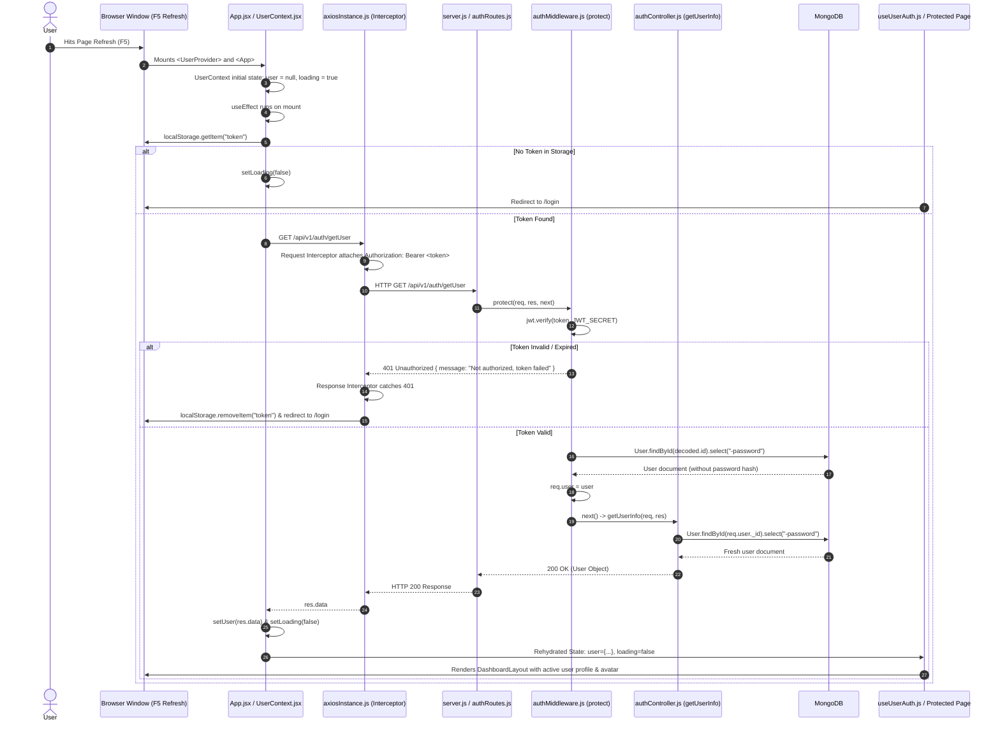
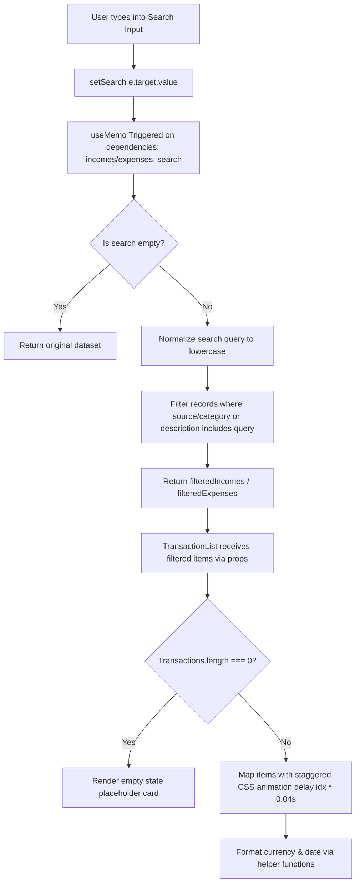
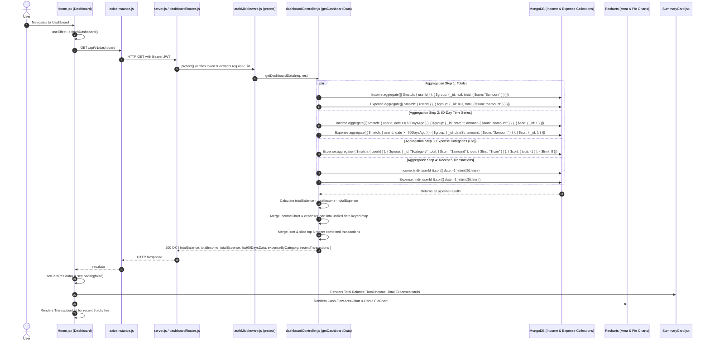
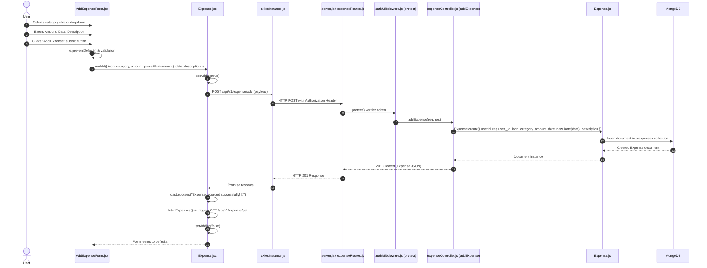

# Full-Stack System Architecture & File-to-File Data Flow Guide
**Application:** ExpenseFlow — Full-Stack Financial Management & Analytics Platform  
**Tech Stack:** React 19, Vite, TailwindCSS, Node.js, Express.js 5, MongoDB (Mongoose 9), JWT, Axios, Multer, xlsx, Recharts  

---

## Executive Summary & System Overview

This document provides an exhaustive, interview-grade architectural breakdown of every core feature and data lifecycle in the ExpenseFlow system. Each section tracks the end-to-end data lifecycle across all five tiers:
1. **Client Action & State** (React 19 Components, State, Context, Custom Hooks)
2. **Network & API Interception** (Axios Instance, Interceptors, Headers, Payloads)
3. **Server Routing & Middleware** (Express 5 Routers, CORS, Multer disk storage, JWT verification)
4. **Controller Logic & DB Interaction** (Controller functions, Mongoose 9 models, aggregation pipelines)
5. **Response & UI Reconciliation** (HTTP codes, Context updates, state mutations, React re-renders)



---

## Table of Contents
1. [Feature 1: User Registration & Profile Photo Upload (Multipart Flow)](#feature-1-user-registration--profile-photo-upload-multipart-flow)
2. [Feature 2: User Authentication & JWT Login](#feature-2-user-authentication--jwt-login)
3. [Feature 3: Session Persistence & User Rehydration on Page Refresh](#feature-3-session-persistence--user-rehydration-on-page-refresh)
4. [Feature 4: Transaction Catalog, Live Search & Client-Side Filtering](#feature-4-transaction-catalog-live-search--client-side-filtering)
5. [Feature 5: Dashboard Financial Aggregations & Balance Analytics Engine](#feature-5-dashboard-financial-aggregations--balance-analytics-engine)
6. [Feature 6: Transaction Creation (Expense & Income Recording)](#feature-6-transaction-creation-expense--income-recording)
7. [Feature 7: Transaction History Retrieval, Deletion & Excel Export](#feature-7-transaction-history-retrieval-deletion--excel-export)
8. [Feature 8: Axios Interceptors & Route Guarding Architecture](#feature-8-axios-interceptors--route-guarding-architecture)

---

## Feature 1: User Registration & Profile Photo Upload (Multipart Flow)

### Architectural File Chain
[`ProfilePhotoSelector.jsx`](file:///c:/Users/drswa/OneDrive/Desktop/Expense%20Tracker/frontend/expense-tracker/src/components/inputs/ProfilePhotoSelector.jsx) $\rightarrow$ [`SignUp.jsx`](file:///c:/Users/drswa/OneDrive/Desktop/Expense%20Tracker/frontend/expense-tracker/src/pages/Auth/SignUp.jsx) $\rightarrow$ [`axiosInstance.js`](file:///c:/Users/drswa/OneDrive/Desktop/Expense%20Tracker/frontend/expense-tracker/src/utils/axiosInstance.js) $\rightarrow$ [`server.js`](file:///c:/Users/drswa/OneDrive/Desktop/Expense%20Tracker/backend/server.js) $\rightarrow$ [`authRoutes.js`](file:///c:/Users/drswa/OneDrive/Desktop/Expense%20Tracker/backend/routes/authRoutes.js) $\rightarrow$ [`uploadMiddleware.js`](file:///c:/Users/drswa/OneDrive/Desktop/Expense%20Tracker/backend/middleware/uploadMiddleware.js) $\rightarrow$ [`authController.js`](file:///c:/Users/drswa/OneDrive/Desktop/Expense%20Tracker/backend/controllers/authController.js) $\rightarrow$ [`User.js`](file:///c:/Users/drswa/OneDrive/Desktop/Expense%20Tracker/backend/models/User.js) $\rightarrow$ [`UserContext.jsx`](file:///c:/Users/drswa/OneDrive/Desktop/Expense%20Tracker/frontend/expense-tracker/src/context/UserContext.jsx) $\rightarrow$ [`Home.jsx`](file:///c:/Users/drswa/OneDrive/Desktop/Expense%20Tracker/frontend/expense-tracker/src/pages/Dashboard/Home.jsx)



### Step-by-Step Breakdown

#### 1. Client Action & State
- **Trigger:** User selects an image file in [`ProfilePhotoSelector.jsx`](file:///c:/Users/drswa/OneDrive/Desktop/Expense%20Tracker/frontend/expense-tracker/src/components/inputs/ProfilePhotoSelector.jsx), enters `fullName`, `email`, and `password` in [`SignUp.jsx`](file:///c:/Users/drswa/OneDrive/Desktop/Expense%20Tracker/frontend/expense-tracker/src/pages/Auth/SignUp.jsx), and clicks the submit button (`<button type="submit">`).
- **Local State Management:** 
  - `profilePic`: Stores the raw binary `File` object via `setImage(file)`.
  - `previewUrl`: Generates a transient URL via `URL.createObjectURL(file)` for instant UI feedback.
  - `fullName`, `email`, `password`: Controlled string states bound to `<Input />` components.
  - `loading`: Boolean state set to `true` during the async operations to disable the submit button.
  - `error`: Error string state populated if validation fails (`!fullName`, `!validateEmail(email)`, `password.length < 6`).

#### 2. Network & API Interception
- **Phase A (Image Upload - Optional):** If `profilePic` exists, a `FormData` object is constructed (`formData.append("image", profilePic)`). It is dispatched via:
  ```javascript
  axiosInstance.post(API_PATHS.AUTH.UPLOAD_IMAGE, formData, {
    headers: { "Content-Type": "multipart/form-data" },
  });
  ```
- **Phase B (User Registration):** After receiving `imageUrl`, [`axiosInstance.js`](file:///c:/Users/drswa/OneDrive/Desktop/Expense%20Tracker/frontend/expense-tracker/src/utils/axiosInstance.js) dispatches a JSON POST payload:
  ```json
  {
    "fullName": "Jane Doe",
    "email": "jane@example.com",
    "password": "securePassword123",
    "profileImageUrl": "uploads/image-1740284400000-123456789.png"
  }
  ```
- **Request Interceptor:** `axiosInstance.interceptors.request` intercepts the outgoing call; since no JWT exists yet, `config.headers.Authorization` remains undefined.

#### 3. Server Routing & Middleware
- **Base Endpoint:** [`server.js`](file:///c:/Users/drswa/OneDrive/Desktop/Expense%20Tracker/backend/server.js) mounts `authRoutes` at `/api/v1/auth`.
- **Upload Route:** `router.post("/upload-image", upload.single("image"))` in [`authRoutes.js`](file:///c:/Users/drswa/OneDrive/Desktop/Expense%20Tracker/backend/routes/authRoutes.js).
  - **Multer Middleware:** [`uploadMiddleware.js`](file:///c:/Users/drswa/OneDrive/Desktop/Expense%20Tracker/backend/middleware/uploadMiddleware.js) configures `diskStorage`. Destination is set to `../uploads/` (auto-created via `fs.mkdirSync` if absent).
  - **Filename Generation:** `${file.fieldname}-${Date.now()}-${Math.round(Math.random() * 1e9)}${ext}`.
  - **MIME Whitelist:** `image/jpeg`, `image/png`, `image/jpg`, `image/webp` with a 5MB size limit (`5 * 1024 * 1024`).
- **Register Route:** `router.post("/register", registerUser)` handles the user registration payload.

#### 4. Controller Logic & DB Interaction
- **Function:** `registerUser(req, res)` in [`authController.js`](file:///c:/Users/drswa/OneDrive/Desktop/Expense%20Tracker/backend/controllers/authController.js).
- **Validation:** Confirms presence of `fullName`, `email`, and `password`. Returns `400 Bad Request` if missing.
- **Uniqueness Check:** Executes `User.findOne({ email })`. If found, halts with `400 Email already in use`.
- **Document Creation:** Executes `User.create({ fullName, email, password, profileImageUrl })`.
- **Mongoose Lifecycle Hook:** Before writing to MongoDB, the `UserSchema.pre("save")` hook in [`User.js`](file:///c:/Users/drswa/OneDrive/Desktop/Expense%20Tracker/backend/models/User.js) executes:
  ```javascript
  const salt = await bcrypt.genSalt(10);
  this.password = await bcrypt.hash(this.password, salt);
  ```
- **Token Generation:** `generateToken(user._id)` executes `jwt.sign({ id: user._id }, process.env.JWT_SECRET, { expiresIn: "7d" })`.

#### 5. Response & UI Reconciliation
- **HTTP Response:** Status `201 Created` with JSON payload:
  ```json
  {
    "id": "65e0a1b2c3d4e5f678901234",
    "user": {
      "_id": "65e0a1b2c3d4e5f678901234",
      "fullName": "Jane Doe",
      "email": "jane@example.com",
      "profileImageUrl": "uploads/image-1740284400000-123456789.png"
    },
    "token": "eyJhbGciOiJIUzI1NiIsInR5cCI6IkpXVCJ9..."
  }
  ```
- **Context Injection:** [`SignUp.jsx`](file:///c:/Users/drswa/OneDrive/Desktop/Expense%20Tracker/frontend/expense-tracker/src/pages/Auth/SignUp.jsx) invokes `login(user, token)` from [`UserContext.jsx`](file:///c:/Users/drswa/OneDrive/Desktop/Expense%20Tracker/frontend/expense-tracker/src/context/UserContext.jsx):
  - Updates React state: `setUser(userData)`.
  - Persists session: `localStorage.setItem("token", token)` and `localStorage.setItem("user", JSON.stringify(userData))`.
- **Navigation:** `toast.success("Account created! Welcome 🎉")` triggers, followed by `navigate("/dashboard")` redirecting the user to the main analytics overview.

---

## Feature 2: User Authentication & JWT Login

### Architectural File Chain
[`Login.jsx`](file:///c:/Users/drswa/OneDrive/Desktop/Expense%20Tracker/frontend/expense-tracker/src/pages/Auth/Login.jsx) $\rightarrow$ [`helper.js`](file:///c:/Users/drswa/OneDrive/Desktop/Expense%20Tracker/frontend/expense-tracker/src/utils/helper.js) $\rightarrow$ [`axiosInstance.js`](file:///c:/Users/drswa/OneDrive/Desktop/Expense%20Tracker/frontend/expense-tracker/src/utils/axiosInstance.js) $\rightarrow$ [`server.js`](file:///c:/Users/drswa/OneDrive/Desktop/Expense%20Tracker/backend/server.js) $\rightarrow$ [`authRoutes.js`](file:///c:/Users/drswa/OneDrive/Desktop/Expense%20Tracker/backend/routes/authRoutes.js) $\rightarrow$ [`authController.js`](file:///c:/Users/drswa/OneDrive/Desktop/Expense%20Tracker/backend/controllers/authController.js) $\rightarrow$ [`User.js`](file:///c:/Users/drswa/OneDrive/Desktop/Expense%20Tracker/backend/models/User.js) $\rightarrow$ [`UserContext.jsx`](file:///c:/Users/drswa/OneDrive/Desktop/Expense%20Tracker/frontend/expense-tracker/src/context/UserContext.jsx) $\rightarrow$ [`Home.jsx`](file:///c:/Users/drswa/OneDrive/Desktop/Expense%20Tracker/frontend/expense-tracker/src/pages/Dashboard/Home.jsx)



### Step-by-Step Breakdown

#### 1. Client Action & State
- **Trigger:** User types credentials into `<Input label="Email address" />` and `<Input label="Password" type="password" />` (with toggleable show/hide eye icon via `FaRegEye` / `FaRegEyeSlash` in [`Input.jsx`](file:///c:/Users/drswa/OneDrive/Desktop/Expense%20Tracker/frontend/expense-tracker/src/components/inputs/Input.jsx)), and submits the form.
- **Client Validation:**
  - `validateEmail(email)` executes `/^[^\s@]+@[^\s@]+\.[^\s@]+$/`. If invalid, `setError("Please enter a valid email address.")`.
  - Checks if `!password`. If empty, `setError("Please enter your password.")`.
- **State Changes:** `loading` set to `true`, clearing previous errors (`setError(null)`).

#### 2. Network & API Interception
- **Request Generation:** [`axiosInstance.js`](file:///c:/Users/drswa/OneDrive/Desktop/Expense%20Tracker/frontend/expense-tracker/src/utils/axiosInstance.js) issues:
  ```javascript
  const res = await axiosInstance.post(API_PATHS.AUTH.LOGIN, { email, password });
  ```
- **Target URL:** `http://localhost:8000/api/v1/auth/login`.

#### 3. Server Routing & Middleware
- **Express Router:** [`authRoutes.js`](file:///c:/Users/drswa/OneDrive/Desktop/Expense%20Tracker/backend/routes/authRoutes.js) maps `router.post("/login", loginUser)`.
- **Parsing:** `express.json()` in [`server.js`](file:///c:/Users/drswa/OneDrive/Desktop/Expense%20Tracker/backend/server.js) parses the raw body into `req.body`.

#### 4. Controller Logic & DB Interaction
- **Function:** `loginUser(req, res)` in [`authController.js`](file:///c:/Users/drswa/OneDrive/Desktop/Expense%20Tracker/backend/controllers/authController.js).
- **Lookup:** Executes `const user = await User.findOne({ email });`.
- **Password Comparison:** If user exists, invokes the schema method `await user.comparePassword(password)` from [`User.js`](file:///c:/Users/drswa/OneDrive/Desktop/Expense%20Tracker/backend/models/User.js):
  ```javascript
  UserSchema.methods.comparePassword = async function (candidatePassword) {
    return bcrypt.compare(candidatePassword, this.password);
  };
  ```
- **Security Check:** If either lookup returns `null` or comparison returns `false`, responds with a uniform `401 Unauthorized` (`{ message: "Invalid credentials" }`) to prevent user enumeration attacks.
- **JWT Signing:** Signs token containing `{ id: user._id }` signed with `process.env.JWT_SECRET` and 7-day expiration.

#### 5. Response & UI Reconciliation
- **HTTP Response:** Status `200 OK` with user profile and token.
- **Client Processing:** [`Login.jsx`](file:///c:/Users/drswa/OneDrive/Desktop/Expense%20Tracker/frontend/expense-tracker/src/pages/Auth/Login.jsx) receives `res.data`, extracts `{ user, token }`, and calls `login(user, token)`.
- **Context Updates:** Sets `user` state in [`UserContext.jsx`](file:///c:/Users/drswa/OneDrive/Desktop/Expense%20Tracker/frontend/expense-tracker/src/context/UserContext.jsx), synchronizes `localStorage`.
- **Navigation:** Triggers `navigate("/dashboard")` redirecting the user to [`Home.jsx`](file:///c:/Users/drswa/OneDrive/Desktop/Expense%20Tracker/frontend/expense-tracker/src/pages/Dashboard/Home.jsx).

---

## Feature 3: Session Persistence & User Rehydration on Page Refresh

### Architectural File Chain
[`main.jsx`](file:///c:/Users/drswa/OneDrive/Desktop/Expense%20Tracker/frontend/expense-tracker/src/main.jsx) $\rightarrow$ [`App.jsx`](file:///c:/Users/drswa/OneDrive/Desktop/Expense%20Tracker/frontend/expense-tracker/src/App.jsx) $\rightarrow$ [`UserContext.jsx`](file:///c:/Users/drswa/OneDrive/Desktop/Expense%20Tracker/frontend/expense-tracker/src/context/UserContext.jsx) $\rightarrow$ [`axiosInstance.js`](file:///c:/Users/drswa/OneDrive/Desktop/Expense%20Tracker/frontend/expense-tracker/src/utils/axiosInstance.js) $\rightarrow$ [`server.js`](file:///c:/Users/drswa/OneDrive/Desktop/Expense%20Tracker/backend/server.js) $\rightarrow$ [`authRoutes.js`](file:///c:/Users/drswa/OneDrive/Desktop/Expense%20Tracker/backend/routes/authRoutes.js) $\rightarrow$ [`authMiddleware.js`](file:///c:/Users/drswa/OneDrive/Desktop/Expense%20Tracker/backend/middleware/authMiddleware.js) $\rightarrow$ [`authController.js`](file:///c:/Users/drswa/OneDrive/Desktop/Expense%20Tracker/backend/controllers/authController.js) $\rightarrow$ [`User.js`](file:///c:/Users/drswa/OneDrive/Desktop/Expense%20Tracker/backend/models/User.js) $\rightarrow$ [`useUserAuth.js`](file:///c:/Users/drswa/OneDrive/Desktop/Expense%20Tracker/frontend/expense-tracker/src/hooks/useUserAuth.js) $\rightarrow$ [`DashboardLayout.jsx`](file:///c:/Users/drswa/OneDrive/Desktop/Expense%20Tracker/frontend/expense-tracker/src/components/layouts/DashboardLayout.jsx)



### Step-by-Step Breakdown

#### 1. Client Action & State
- **Trigger:** Browser window reload or fresh navigation to any route (`/`, `/dashboard`, `/income`, `/expense`).
- **Initial Context State:** [`UserContext.jsx`](file:///c:/Users/drswa/OneDrive/Desktop/Expense%20Tracker/frontend/expense-tracker/src/context/UserContext.jsx) initializes with `user = null` and `loading = true`.
- **Mount Effect:** `useEffect` executes immediately on mount:
  ```javascript
  const token = localStorage.getItem("token");
  if (token) {
    axiosInstance.get(API_PATHS.AUTH.GET_USER)
      .then(res => setUser(res.data))
      .catch(() => {
        localStorage.removeItem("token");
        localStorage.removeItem("user");
        setUser(null);
      })
      .finally(() => setLoading(false));
  } else {
    setLoading(false);
  }
  ```

#### 2. Network & API Interception
- **Request Configuration:** GET request dispatched to `/api/v1/auth/getUser`.
- **Axios Request Interceptor:** Located in [`axiosInstance.js`](file:///c:/Users/drswa/OneDrive/Desktop/Expense%20Tracker/frontend/expense-tracker/src/utils/axiosInstance.js):
  ```javascript
  axiosInstance.interceptors.request.use((config) => {
    const token = localStorage.getItem("token");
    if (token) {
      config.headers.Authorization = `Bearer ${token}`;
    }
    return config;
  });
  ```

#### 3. Server Routing & Middleware
- **Routing:** [`authRoutes.js`](file:///c:/Users/drswa/OneDrive/Desktop/Expense%20Tracker/backend/routes/authRoutes.js) defines:
  ```javascript
  router.get("/getUser", protect, getUserInfo);
  ```
- **Authentication Middleware:** `protect` in [`authMiddleware.js`](file:///c:/Users/drswa/OneDrive/Desktop/Expense%20Tracker/backend/middleware/authMiddleware.js):
  1. Inspects `req.headers.authorization`.
  2. Verifies format begins with `"Bearer "`.
  3. Decodes JWT using `jwt.verify(token, process.env.JWT_SECRET)`.
  4. Queries MongoDB: `req.user = await User.findById(decoded.id).select("-password")`.
  5. If user does not exist or token is invalid, returns `401 Unauthorized`.
  6. Calls `next()` to hand off control.

#### 4. Controller Logic & DB Interaction
- **Function:** `getUserInfo(req, res)` in [`authController.js`](file:///c:/Users/drswa/OneDrive/Desktop/Expense%20Tracker/backend/controllers/authController.js).
- **Execution:** Performs a final query check `const user = await User.findById(req.user._id).select("-password")`.
- **Return:** Responds with status `200 OK` and the sanitized user profile JSON.

#### 5. Response & UI Reconciliation
- **State Rehydration:** `setUser(res.data)` sets the global `user` object containing `_id`, `fullName`, `email`, `profileImageUrl`.
- **Guard Validation:** The custom hook [`useUserAuth.js`](file:///c:/Users/drswa/OneDrive/Desktop/Expense%20Tracker/frontend/expense-tracker/src/hooks/useUserAuth.js) monitors `loading` and `user`. When `loading` transitions to `false` with a valid `user`, the dashboard view renders smoothly without redirecting.
- **UI Update:** [`DashboardLayout.jsx`](file:///c:/Users/drswa/OneDrive/Desktop/Expense%20Tracker/frontend/expense-tracker/src/components/layouts/DashboardLayout.jsx) renders the user profile card, dynamic avatar image (or initials fallback `user.fullName.charAt(0)`), and online status indicator.

---

## Feature 4: Transaction Catalog, Live Search & Client-Side Filtering

### Architectural File Chain
[`Income.jsx`](file:///c:/Users/drswa/OneDrive/Desktop/Expense%20Tracker/frontend/expense-tracker/src/pages/Dashboard/Income.jsx) / [`Expense.jsx`](file:///c:/Users/drswa/OneDrive/Desktop/Expense%20Tracker/frontend/expense-tracker/src/pages/Dashboard/Expense.jsx) $\rightarrow$ React `useMemo` $\rightarrow$ [`TransactionList.jsx`](file:///c:/Users/drswa/OneDrive/Desktop/Expense%20Tracker/frontend/expense-tracker/src/components/Dashboard/TransactionList.jsx) $\rightarrow$ [`data.js`](file:///c:/Users/drswa/OneDrive/Desktop/Expense%20Tracker/frontend/expense-tracker/src/utils/data.js)



### Step-by-Step Breakdown

#### 1. Client Action & State
- **Trigger:** User enters text into the search input bar (`<input placeholder="Search income..." />` or `<input placeholder="Search expense..." />`).
- **State Capture:** Triggers `onChange={(e) => setSearch(e.target.value)}`.
- **Search Query State:** Captured in local component state `search` in [`Income.jsx`](file:///c:/Users/drswa/OneDrive/Desktop/Expense%20Tracker/frontend/expense-tracker/src/pages/Dashboard/Income.jsx) and [`Expense.jsx`](file:///c:/Users/drswa/OneDrive/Desktop/Expense%20Tracker/frontend/expense-tracker/src/pages/Dashboard/Expense.jsx).

#### 2. Filtering Pipeline & Memoization
- **Optimization:** Utilizes React’s `useMemo` hook to avoid expensive recalculations on non-search re-renders:
  ```javascript
  // In Income.jsx
  const filteredIncomes = useMemo(() => {
    if (!search.trim()) return incomes;
    const q = search.toLowerCase();
    return incomes.filter(
      (i) =>
        i.source?.toLowerCase().includes(q) ||
        i.description?.toLowerCase().includes(q)
    );
  }, [incomes, search]);
  ```
  ```javascript
  // In Expense.jsx
  const filteredExpenses = useMemo(() => {
    if (!search.trim()) return expenses;
    const q = search.toLowerCase();
    return expenses.filter(
      (e) =>
        e.category?.toLowerCase().includes(q) ||
        e.description?.toLowerCase().includes(q)
    );
  }, [expenses, search]);
  ```

#### 3. Component Architecture & Props Delegation
- **Component:** [`TransactionList.jsx`](file:///c:/Users/drswa/OneDrive/Desktop/Expense%20Tracker/frontend/expense-tracker/src/components/Dashboard/TransactionList.jsx).
- **Passed Props:**
  - `transactions`: Array of filtered transaction objects (`filteredIncomes` or `filteredExpenses`).
  - `type`: `"income"` or `"expense"`.
  - `onDelete`: Delete handler function reference (`handleDelete`).
  - `loading`: Boolean fetch indicator.

#### 4. Formatting & Domain Logic Interaction
- **Helpers:** Data formatting functions imported from [`data.js`](file:///c:/Users/drswa/OneDrive/Desktop/Expense%20Tracker/frontend/expense-tracker/src/utils/data.js):
  - `formatCurrency(amount)`: Uses `Intl.NumberFormat("en-IN", { style: "currency", currency: "INR", maximumFractionDigits: 0 })`.
  - `formatDate(date)`: Uses `toLocaleDateString("en-IN", { day: "2-digit", month: "short", year: "numeric" })`.

#### 5. UI Reconciliation & Rendering
- **Item Badges & Colors:**
  - Income: Green theme (`text-emerald-400`, `bg-emerald-500/10`, `+` prefix).
  - Expense: Rose theme (`text-rose-400`, `bg-rose-500/10`, `-` prefix).
- **Staggered Animations:** Each item renders with `style={{ animationDelay: `${idx * 0.04}s` }}` for smooth, cascading entry animations.
- **Empty State:** If the filtered array is empty, renders an empty state card with contextual messaging.

---

## Feature 5: Dashboard Financial Aggregations & Balance Analytics Engine

### Architectural File Chain
[`Home.jsx`](file:///c:/Users/drswa/OneDrive/Desktop/Expense%20Tracker/frontend/expense-tracker/src/pages/Dashboard/Home.jsx) $\rightarrow$ [`axiosInstance.js`](file:///c:/Users/drswa/OneDrive/Desktop/Expense%20Tracker/frontend/expense-tracker/src/utils/axiosInstance.js) $\rightarrow$ [`server.js`](file:///c:/Users/drswa/OneDrive/Desktop/Expense%20Tracker/backend/server.js) $\rightarrow$ [`dashboardRoutes.js`](file:///c:/Users/drswa/OneDrive/Desktop/Expense%20Tracker/backend/routes/dashboardRoutes.js) $\rightarrow$ [`authMiddleware.js`](file:///c:/Users/drswa/OneDrive/Desktop/Expense%20Tracker/backend/middleware/authMiddleware.js) $\rightarrow$ [`dashboardController.js`](file:///c:/Users/drswa/OneDrive/Desktop/Expense%20Tracker/backend/controllers/dashboardController.js) $\rightarrow$ [`Income.js`](file:///c:/Users/drswa/OneDrive/Desktop/Expense%20Tracker/backend/models/Income.js) & [`Expense.js`](file:///c:/Users/drswa/OneDrive/Desktop/Expense%20Tracker/backend/models/Expense.js) $\rightarrow$ [`SummaryCard.jsx`](file:///c:/Users/drswa/OneDrive/Desktop/Expense%20Tracker/frontend/expense-tracker/src/components/Dashboard/SummaryCard.jsx) & Recharts (`AreaChart`, `PieChart`)



### Step-by-Step Breakdown

#### 1. Client Action & State
- **Trigger:** User navigates to `/dashboard` or successfully logs in.
- **Hook & State:** [`Home.jsx`](file:///c:/Users/drswa/OneDrive/Desktop/Expense%20Tracker/frontend/expense-tracker/src/pages/Dashboard/Home.jsx) invokes `useUserAuth()` to guard the route, declares `data` (initialized to `null`), and `loading` (initialized to `true`).
- **Fetch Invocation:** `useCallback` wraps `fetchDashboard()`, called by `useEffect` on mount.

#### 2. Network & API Interception
- **API Call:** Dispatches `axiosInstance.get(API_PATHS.DASHBOARD.GET)`.
- **Headers:** Attached via request interceptor: `Authorization: Bearer <jwt_token>`.

#### 3. Server Routing & Middleware
- **Router:** [`dashboardRoutes.js`](file:///c:/Users/drswa/OneDrive/Desktop/Expense%20Tracker/backend/routes/dashboardRoutes.js) declares `router.get("/", protect, getDashboardData)`.
- **Guard:** [`authMiddleware.js`](file:///c:/Users/drswa/OneDrive/Desktop/Expense%20Tracker/backend/middleware/authMiddleware.js) populates `req.user._id`.

#### 4. Controller Logic & DB Interaction (Aggregation Engine)
Executed in `getDashboardData` in [`dashboardController.js`](file:///c:/Users/drswa/OneDrive/Desktop/Expense%20Tracker/backend/controllers/dashboardController.js):
1. **Parallel Aggregation of Totals:**
   ```javascript
   const [totalIncomeResult, totalExpenseResult] = await Promise.all([
     Income.aggregate([
       { $match: { userId } },
       { $group: { _id: null, total: { $sum: "$amount" } } },
     ]),
     Expense.aggregate([
       { $match: { userId } },
       { $group: { _id: null, total: { $sum: "$amount" } } },
     ]),
   ]);
   const totalIncome = totalIncomeResult[0]?.total || 0;
   const totalExpense = totalExpenseResult[0]?.total || 0;
   const totalBalance = totalIncome - totalExpense;
   ```
2. **60-Day Area Chart Time-Series Pipeline:**
   Calculates `sixtyDaysAgo` date threshold and runs `$match` with `$dateToString` grouping on both `Income` and `Expense` collections. Merges results in memory using `chartDataMap` to ensure zero-filled dates align on the X-axis.
3. **Expense Breakdown by Category (Pie Chart):**
   ```javascript
   const expenseByCategory = await Expense.aggregate([
     { $match: { userId } },
     { $group: { _id: "$category", total: { $sum: "$amount" }, icon: { $first: "$icon" } } },
     { $sort: { total: -1 } },
     { $limit: 8 },
   ]);
   ```
4. **Recent Combined Transactions Feed:**
   Queries top 5 records from each model with `.lean()`, tags them with `type: "income"` / `type: "expense"`, sorts chronologically descending, and slices the top 5.

#### 5. Response & UI Reconciliation
- **Payload:** Dispatched with status `200 OK`.
- **UI Components Hydrated:**
  - [`SummaryCard.jsx`](file:///c:/Users/drswa/OneDrive/Desktop/Expense%20Tracker/frontend/expense-tracker/src/components/Dashboard/SummaryCard.jsx): 3 stat cards for Balance (purple), Income (emerald), and Expenses (rose).
  - **Recharts AreaChart:** Double gradient fill (`#gradIncome` / `#gradExpense`) for cash flow dynamics with custom glassmorphic `AreaTooltip`.
  - **Recharts PieChart:** Donut chart (`innerRadius={60}`, `outerRadius={90}`) with dynamic color mapping from `PIE_COLORS`.
  - **Recent Activity:** [`TransactionList.jsx`](file:///c:/Users/drswa/OneDrive/Desktop/Expense%20Tracker/frontend/expense-tracker/src/components/Dashboard/TransactionList.jsx) displays recent items.

---

## Feature 6: Transaction Creation (Expense & Income Recording)

### Architectural File Chain
[`AddExpenseForm.jsx`](file:///c:/Users/drswa/OneDrive/Desktop/Expense%20Tracker/frontend/expense-tracker/src/components/Dashboard/AddExpenseForm.jsx) / [`AddIncomeForm.jsx`](file:///c:/Users/drswa/OneDrive/Desktop/Expense%20Tracker/frontend/expense-tracker/src/components/Dashboard/AddIncomeForm.jsx) $\rightarrow$ [`Expense.jsx`](file:///c:/Users/drswa/OneDrive/Desktop/Expense%20Tracker/frontend/expense-tracker/src/pages/Dashboard/Expense.jsx) / [`Income.jsx`](file:///c:/Users/drswa/OneDrive/Desktop/Expense%20Tracker/frontend/expense-tracker/src/pages/Dashboard/Income.jsx) $\rightarrow$ [`axiosInstance.js`](file:///c:/Users/drswa/OneDrive/Desktop/Expense%20Tracker/frontend/expense-tracker/src/utils/axiosInstance.js) $\rightarrow$ [`server.js`](file:///c:/Users/drswa/OneDrive/Desktop/Expense%20Tracker/backend/server.js) $\rightarrow$ [`expenseRoutes.js`](file:///c:/Users/drswa/OneDrive/Desktop/Expense%20Tracker/backend/routes/expenseRoutes.js) / [`incomeRoutes.js`](file:///c:/Users/drswa/OneDrive/Desktop/Expense%20Tracker/backend/routes/incomeRoutes.js) $\rightarrow$ [`authMiddleware.js`](file:///c:/Users/drswa/OneDrive/Desktop/Expense%20Tracker/backend/middleware/authMiddleware.js) $\rightarrow$ [`expenseController.js`](file:///c:/Users/drswa/OneDrive/Desktop/Expense%20Tracker/backend/controllers/expenseController.js) / [`incomeController.js`](file:///c:/Users/drswa/OneDrive/Desktop/Expense%20Tracker/backend/controllers/incomeController.js) $\rightarrow$ [`Expense.js`](file:///c:/Users/drswa/OneDrive/Desktop/Expense%20Tracker/backend/models/Expense.js) / [`Income.js`](file:///c:/Users/drswa/OneDrive/Desktop/Expense%20Tracker/backend/models/Income.js)



### Step-by-Step Breakdown

#### 1. Client Action & State
- **Trigger:** User interacts with `<AddExpenseForm />` in [`AddExpenseForm.jsx`](file:///c:/Users/drswa/OneDrive/Desktop/Expense%20Tracker/frontend/expense-tracker/src/components/Dashboard/AddExpenseForm.jsx) or `<AddIncomeForm />` in [`AddIncomeForm.jsx`](file:///c:/Users/drswa/OneDrive/Desktop/Expense%20Tracker/frontend/expense-tracker/src/components/Dashboard/AddIncomeForm.jsx).
- **Interactive Preset Chips:** Clicking a preset chip (e.g., `"Food & Dining"` or `"Salary"`) triggers `handleCategorySelect(c)` or `handleSourceSelect(s)`, synchronizing both `category`/`source` label and its associated emoji `icon`.
- **Form State:** Held in `form` state object `{ icon, category/source, amount, date, description }`.
- **Submit Handling:** Submits via `handleSubmit`, casts `amount` via `parseFloat(form.amount)`, and invokes `onAdd(payload)`.

#### 2. Network & API Interception
- **API Request:** Dispatched by the parent page component via `axiosInstance`:
  ```javascript
  // In Expense.jsx
  await axiosInstance.post(API_PATHS.EXPENSE.ADD, formData);
  // In Income.jsx
  await axiosInstance.post(API_PATHS.INCOME.ADD, formData);
  ```
- **Payload Schema:**
  ```json
  {
    "icon": "🍔",
    "category": "Food & Dining",
    "amount": 450,
    "date": "2026-08-23",
    "description": "Team lunch"
  }
  ```

#### 3. Server Routing & Middleware
- **Routes:** Handled in [`expenseRoutes.js`](file:///c:/Users/drswa/OneDrive/Desktop/Expense%20Tracker/backend/routes/expenseRoutes.js) (`router.post("/add", protect, addExpense)`) and [`incomeRoutes.js`](file:///c:/Users/drswa/OneDrive/Desktop/Expense%20Tracker/backend/routes/incomeRoutes.js) (`router.post("/add", protect, addIncome)`).
- **Authentication:** `protect` middleware authenticates the caller and attaches `req.user._id`.

#### 4. Controller Logic & DB Interaction
- **Functions:** `addExpense` in [`expenseController.js`](file:///c:/Users/drswa/OneDrive/Desktop/Expense%20Tracker/backend/controllers/expenseController.js) and `addIncome` in [`incomeController.js`](file:///c:/Users/drswa/OneDrive/Desktop/Expense%20Tracker/backend/controllers/incomeController.js).
- **Validation:** Ensures mandatory fields exist (`category`/`source`, `amount`, `date`).
- **Database Write:** Executes `create` on the Mongoose model, automatically assigning `userId: req.user._id`:
  ```javascript
  const expense = await Expense.create({
    userId: req.user._id,
    icon,
    category,
    amount,
    date: new Date(date),
    description,
  });
  ```

#### 5. Response & UI Reconciliation
- **HTTP Response:** Returns `201 Created` with the newly created document.
- **State Invalidation & Refetch:** The parent page component (`Expense.jsx` / `Income.jsx`) triggers:
  1. `toast.success("Expense recorded successfully! 💸")`.
  2. `await fetchExpenses()` / `await fetchIncomes()` to refetch the updated collection.
  3. Form fields reset to default values.
  4. Monthly bar chart and total summary balance dynamically recalculate and re-render.

---

## Feature 7: Transaction History Retrieval, Deletion & Excel Export

### Architectural File Chain
[`Income.jsx`](file:///c:/Users/drswa/OneDrive/Desktop/Expense%20Tracker/frontend/expense-tracker/src/pages/Dashboard/Income.jsx) / [`Expense.jsx`](file:///c:/Users/drswa/OneDrive/Desktop/Expense%20Tracker/frontend/expense-tracker/src/pages/Dashboard/Expense.jsx) $\rightarrow$ [`TransactionList.jsx`](file:///c:/Users/drswa/OneDrive/Desktop/Expense%20Tracker/frontend/expense-tracker/src/components/Dashboard/TransactionList.jsx) $\rightarrow$ [`axiosInstance.js`](file:///c:/Users/drswa/OneDrive/Desktop/Expense%20Tracker/frontend/expense-tracker/src/utils/axiosInstance.js) $\rightarrow$ [`server.js`](file:///c:/Users/drswa/OneDrive/Desktop/Expense%20Tracker/backend/server.js) $\rightarrow$ [`expenseRoutes.js`](file:///c:/Users/drswa/OneDrive/Desktop/Expense%20Tracker/backend/routes/expenseRoutes.js) / [`incomeRoutes.js`](file:///c:/Users/drswa/OneDrive/Desktop/Expense%20Tracker/backend/routes/incomeRoutes.js) $\rightarrow$ [`authMiddleware.js`](file:///c:/Users/drswa/OneDrive/Desktop/Expense%20Tracker/backend/middleware/authMiddleware.js) $\rightarrow$ [`expenseController.js`](file:///c:/Users/drswa/OneDrive/Desktop/Expense%20Tracker/backend/controllers/expenseController.js) / [`incomeController.js`](file:///c:/Users/drswa/OneDrive/Desktop/Expense%20Tracker/backend/controllers/incomeController.js) $\rightarrow$ [`xlsx` library](file:///c:/Users/drswa/OneDrive/Desktop/Expense%20Tracker/backend/package.json)

```mermaid
sequenceDiagram
    autonumber
    actor User
    participant Page as Income.jsx / Expense.jsx
    participant List as TransactionList.jsx
    participant Axios as axiosInstance.js
    participant Server as server.js
    participant Mid as authMiddleware.js (protect)
    participant Ctrl as incomeController.js / expenseController.js
    participant DB as MongoDB
    participant XLSX as xlsx Library

    Note over User,DB: --- Flow A: Fetch Transactions ---
    Page->>Axios: GET /api/v1/expense/get
    Axios->>Server: HTTP GET with Bearer JWT
    Server->>Mid: protect() extracts req.user._id
    Mid->>Ctrl: getAllExpenses(req, res)
    Ctrl->>DB: Expense.find({ userId: req.user._id }).sort({ date: -1 })
    DB-->>Ctrl: Sorted array of Expense documents
    Ctrl-->>Server: 200 OK (JSON array)
    Server-->>Axios: HTTP 200 Response
    Axios-->>Page: setExpenses(res.data)
    Page->>List: Passes data to render transaction cards

    Note over User,DB: --- Flow B: Delete Transaction ---
    User->>List: Clicks Trash icon on item
    List->>Page: onDelete(id)
    Page->>Axios: DELETE /api/v1/expense/:id
    Axios->>Server: HTTP DELETE with Bearer JWT
    Server->>Mid: protect()
    Mid->>Ctrl: deleteExpense(req, res)
    Ctrl->>DB: Expense.findById(req.params.id)
    DB-->>Ctrl: expense document
    Ctrl->>Ctrl: Check ownership: expense.userId.toString() === req.user._id.toString()
    Ctrl->>DB: expense.deleteOne()
    DB-->>Ctrl: Deletion confirmed
    Ctrl-->>Server: 200 OK { message: "Expense deleted successfully" }
    Server-->>Axios: HTTP 200 Response
    Axios-->>Page: Promise resolves
    Page->>Page: Optimistic State Update: setExpenses(prev => prev.filter(t => t._id !== id))
    Page->>Page: toast.success("Expense removed")

    Note over User,DB: --- Flow C: Export Excel (.xlsx) ---
    User->>Page: Clicks "Export Excel" button
    Page->>Server: window.open(http://localhost:8000/api/v1/expense/downloadexcel, "_blank")
    Server->>Mid: protect()
    Mid->>Ctrl: downloadExpenseExcel(req, res)
    Ctrl->>DB: Expense.find({ userId: req.user._id }).sort({ date: -1 })
    DB-->>Ctrl: Array of documents
    Ctrl->>Ctrl: Map documents to clean tabular JSON structure
    Ctrl->>XLSX: xlsx.utils.book_new() & json_to_sheet(data)
    Ctrl->>XLSX: xlsx.write(wb, { type: "buffer", bookType: "xlsx" })
    XLSX-->>Ctrl: Binary buffer
    Ctrl->>Server: Set Header: Content-Disposition: attachment; filename=expenses.xlsx
    Ctrl->>Server: Set Header: Content-Type: application/vnd.openxmlformats-officedocument.spreadsheetml.sheet
    Ctrl-->>User: Binary file download stream
```

### Step-by-Step Breakdown

#### 1. Transaction Retrieval Flow
- **Client Action:** Component mount triggers `fetchIncomes()` in [`Income.jsx`](file:///c:/Users/drswa/OneDrive/Desktop/Expense%20Tracker/frontend/expense-tracker/src/pages/Dashboard/Income.jsx) or `fetchExpenses()` in [`Expense.jsx`](file:///c:/Users/drswa/OneDrive/Desktop/Expense%20Tracker/frontend/expense-tracker/src/pages/Dashboard/Expense.jsx).
- **API Call:** GET request dispatched to `/api/v1/income/get` or `/api/v1/expense/get`.
- **Database Query:** Executes `find({ userId: req.user._id }).sort({ date: -1 })` to return all transactions ordered newest to oldest.
- **Client Reconciliation:** State updated via `setIncomes(res.data)` / `setExpenses(res.data)`.

#### 2. Ownership-Guarded Deletion Flow
- **Client Action:** User clicks the trash icon button in [`TransactionList.jsx`](file:///c:/Users/drswa/OneDrive/Desktop/Expense%20Tracker/frontend/expense-tracker/src/components/Dashboard/TransactionList.jsx).
- **API Call:** `axiosInstance.delete(API_PATHS.EXPENSE.DELETE(id))` targeting `/api/v1/expense/:id`.
- **Controller Security Check:** In [`expenseController.js`](file:///c:/Users/drswa/OneDrive/Desktop/Expense%20Tracker/backend/controllers/expenseController.js) / [`incomeController.js`](file:///c:/Users/drswa/OneDrive/Desktop/Expense%20Tracker/backend/controllers/incomeController.js):
  ```javascript
  const expense = await Expense.findById(req.params.id);
  if (!expense) return res.status(404).json({ message: "Expense not found" });
  if (expense.userId.toString() !== req.user._id.toString()) {
    return res.status(403).json({ message: "Not authorized to delete this expense" });
  }
  await expense.deleteOne();
  ```
- **Optimistic State Update:** Upon receiving `200 OK`, client state immediately filters out the deleted item without requiring a full network refetch:
  ```javascript
  setExpenses((prev) => prev.filter((t) => t._id !== id));
  ```

#### 3. Excel Spreadsheet Export Flow
- **Client Action:** User clicks `"Export Excel"` in the header.
- **Invocation:** Dispatches `window.open(`${BASE_URL}${API_PATHS.EXPENSE.DOWNLOAD_EXCEL}`, "_blank")`.
- **Spreadsheet Generation:** Handled by `downloadExpenseExcel` / `downloadIncomeExcel`:
  1. Queries all records for the user from MongoDB.
  2. Maps fields to user-friendly column headers:
     ```javascript
     const data = expenses.map((exp) => ({
       Category: exp.category,
       Icon: exp.icon,
       Amount: exp.amount,
       Date: exp.date.toISOString().split("T")[0],
       Description: exp.description || "",
     }));
     ```
  3. Uses SheetJS (`xlsx`) to create an in-memory workbook:
     ```javascript
     const wb = xlsx.utils.book_new();
     const ws = xlsx.utils.json_to_sheet(data);
     xlsx.utils.book_append_sheet(wb, ws, "Expenses");
     const buffer = xlsx.write(wb, { type: "buffer", bookType: "xlsx" });
     ```
  4. Dispatches raw binary with HTTP headers:
     - `Content-Disposition: attachment; filename=expenses.xlsx`
     - `Content-Type: application/vnd.openxmlformats-officedocument.spreadsheetml.sheet`
- **Browser Execution:** The browser receives the binary stream and immediately prompts a native file download.

---

## Feature 8: Axios Interceptors & Route Guarding Architecture

### Architectural File Chain
[`axiosInstance.js`](file:///c:/Users/drswa/OneDrive/Desktop/Expense%20Tracker/frontend/expense-tracker/src/utils/axiosInstance.js) $\leftrightarrow$ [`useUserAuth.js`](file:///c:/Users/drswa/OneDrive/Desktop/Expense%20Tracker/frontend/expense-tracker/src/hooks/useUserAuth.js) $\leftrightarrow$ [`UserContext.jsx`](file:///c:/Users/drswa/OneDrive/Desktop/Expense%20Tracker/frontend/expense-tracker/src/context/UserContext.jsx) $\leftrightarrow$ [`App.jsx`](file:///c:/Users/drswa/OneDrive/Desktop/Expense%20Tracker/frontend/expense-tracker/src/App.jsx) $\leftrightarrow$ [`authMiddleware.js`](file:///c:/Users/drswa/OneDrive/Desktop/Expense%20Tracker/backend/middleware/authMiddleware.js)

```mermaid
flowchart TD
    subgraph ClientRequest ["Client Outgoing Request"]
        REQ[Axios Request Triggered] --> REQ_INT[Request Interceptor]
        REQ_INT --> CHECK_TOKEN{Token in LocalStorage?}
        CHECK_TOKEN -- Yes --> ATTACH[Attach Authorization: Bearer token]
        CHECK_TOKEN -- No --> PASS[Send Request without Header]
        ATTACH --> SEND[Network Transmission]
        PASS --> SEND
    end

    subgraph ClientResponse ["Client Incoming Response"]
        RESP[Axios Response Received] --> RESP_INT[Response Interceptor]
        RESP_INT --> STATUS{HTTP Status == 401?}
        STATUS -- No --> OK[Pass Response Data to Caller]
        STATUS -- Yes --> PURGE[localStorage.removeItem 'token']
        PURGE --> REDIRECT[window.location.href = '/login']
    end

    subgraph RouteGuarding ["Client Route Guarding (useUserAuth)"]
        PAGE_MOUNT[Protected Dashboard Page Mounts] --> CALL_HOOK[useUserAuth Hook Executes]
        CALL_HOOK --> CHECK_AUTH{loading == false AND user == null?}
        CHECK_AUTH -- Yes --> NAV_LOGIN[navigate to /login replace: true]
        CHECK_AUTH -- No --> RENDER_PAGE[Render Page Content]
    end
```



### Step-by-Step Breakdown

#### 1. Outgoing Request Interceptor
In [`axiosInstance.js`](file:///c:/Users/drswa/OneDrive/Desktop/Expense%20Tracker/frontend/expense-tracker/src/utils/axiosInstance.js):
- Intercepts every outgoing HTTP call.
- Reads `localStorage.getItem("token")`.
- If present, injects `config.headers.Authorization = 'Bearer ' + token`.
- Enforces a unified 10,000ms timeout and `application/json` default `Content-Type`.

#### 2. Incoming Response Interceptor (Global 401 Eviction)
In [`axiosInstance.js`](file:///c:/Users/drswa/OneDrive/Desktop/Expense%20Tracker/frontend/expense-tracker/src/utils/axiosInstance.js):
- Transparently passes through successful responses (`response => response`).
- Catches HTTP error responses. If `error.response?.status === 401`:
  1. Purges corrupted or expired JWT tokens: `localStorage.removeItem("token")`.
  2. Forces a hard redirect to the login screen: `window.location.href = "/login"`.

#### 3. Client Route Protection Hook
In [`useUserAuth.js`](file:///c:/Users/drswa/OneDrive/Desktop/Expense%20Tracker/frontend/expense-tracker/src/hooks/useUserAuth.js):
```javascript
const useUserAuth = () => {
  const { user, loading } = useUser();
  const navigate = useNavigate();

  useEffect(() => {
    if (!loading && !user) {
      navigate("/login", { replace: true });
    }
  }, [user, loading, navigate]);

  return { user, loading };
};
```
- Embedded at the root of [`Home.jsx`](file:///c:/Users/drswa/OneDrive/Desktop/Expense%20Tracker/frontend/expense-tracker/src/pages/Dashboard/Home.jsx), [`Income.jsx`](file:///c:/Users/drswa/OneDrive/Desktop/Expense%20Tracker/frontend/expense-tracker/src/pages/Dashboard/Income.jsx), and [`Expense.jsx`](file:///c:/Users/drswa/OneDrive/Desktop/Expense%20Tracker/frontend/expense-tracker/src/pages/Dashboard/Expense.jsx).
- Ensures non-authenticated visitors are redirected before internal dashboard layouts initialize.

---

## Senior Technical Interviewer Cheat Sheet

When explaining this codebase during technical architecture interviews, highlight these high-yield design decisions and trade-offs:

| Architectural Area | Implementation Decision | Interview Defense & Talking Points |
| :--- | :--- | :--- |
| **Authentication & Tokens** | Stateless JWT (stored in localStorage) + Bearer auth | Eliminates server-side session stores, enabling horizontal scaling across stateless containerized nodes. |
| **Password Security** | Mongoose `pre("save")` hook + `bcryptjs` (10 rounds) | Guarantees passwords can never be stored in plain text, even if developer forgets to hash in a controller. |
| **File Uploads** | Multer disk storage + static `/uploads` serving | Separates file I/O from user creation into two discrete API stages, preventing orphaned database records if image uploads fail. |
| **Aggregations** | MongoDB Aggregation Pipelines (`$match`, `$group`, `$sum`) | Pushes heavy math computations to the database engine rather than loading large arrays of records into Node.js memory. |
| **Excel Generation** | Server-side SheetJS streaming buffer | Generates `.xlsx` on-the-fly without saving temporary files to server disk, minimizing filesystem fragmentation and memory leaks. |
| **Client Performance** | `useMemo` search filters + optimistic UI deletions | Instant UI filtering without debouncing lag; immediate card removal on delete without waiting for network round-trip refetches. |
| **Error Handling** | Axios interceptor with unified 401 revocation | Centralized session expiration handling in one interceptor rather than duplicating auth-checking logic across every React component. |

---
*Generated by Antigravity Full-Stack System Architect Engine.*
