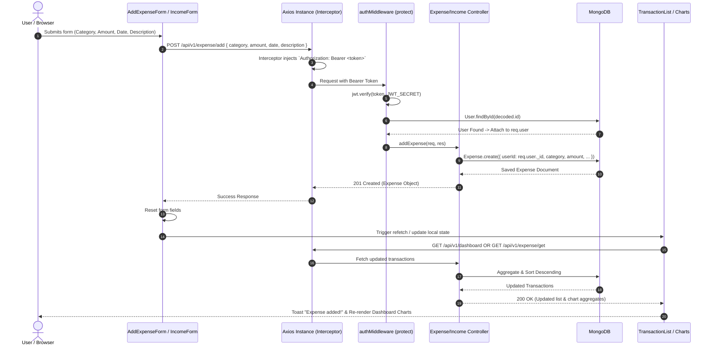
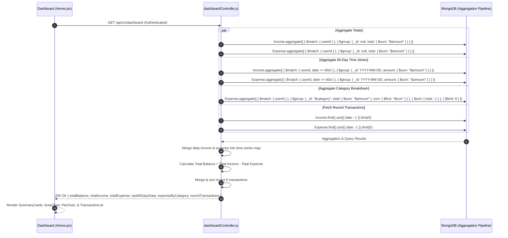

# 💸 ExpenseFlow — Full-Stack MERN Expense Tracker & Analytics Platform

[](https://reactjs.org/)
[](https://vitejs.dev/)
[](https://tailwindcss.com/)
[](LICENSE)

> A modern, production-grade financial management web application built on the **MERN** (MongoDB, Express.js, React, Node.js) stack. Features complete CRUD operations for income and expenses, aggregated cash flow analytics, interactive Recharts visualizations, XLSX data exports, JWT-based authentication, and a responsive glassmorphic dark-mode interface.

---

## 📑 Table of Contents

- [Project Overview & Key Features](#-project-overview--key-features)
- [System Architecture & Repository Structure](#-system-architecture--repository-structure)
- [Tech Stack & Technical Decisions](#-tech-stack--technical-decisions)
- [Detailed Workflows & Sequence Diagrams](#-detailed-workflows--sequence-diagrams)
  - [1. Authentication & Session Persistence Flow](#1-authentication--session-persistence-flow)
  - [2. Transaction Lifecycle Flow (Add/Delete)](#2-transaction-lifecycle-flow-adddelete)
  - [3. Dashboard Aggregation & Data Analytics Flow](#3-dashboard-aggregation--data-analytics-flow)
- [API Endpoints Reference](#-api-endpoints-reference)
- [Database Models & Schemas](#-database-models--schemas)
- [Getting Started & Local Setup](#-getting-started--local-setup)
  - [Prerequisites](#prerequisites)
  - [1. Environment Configuration](#1-environment-configuration)
  - [2. Backend Setup](#2-backend-setup)
  - [3. Frontend Setup](#3-frontend-setup)
- [Security & Performance Highlights](#-security--performance-highlights)
- [Interview Q&A Walkthrough Guide](#-interview-qa-walkthrough-guide)

---

## 🌟 Project Overview & Key Features

ExpenseFlow provides individuals and businesses with real-time clarity over their financial health. It replaces static spreadsheets with an interactive, categorized, and visually rich dashboard.

### 🚀 Key Capabilities:
- 🔐 **Secure JWT Authentication**: Full signup and login workflows with password hashing (`bcryptjs`), persistent sessions, and protected route wrappers.
- 🖼️ **Profile Management & Multi-Part Uploads**: Supports avatar photo uploads using `multer` middleware with static file serving.
- 💵 **Dual-Stream Transaction Management**: Independent modules for **Income** (Salary, Freelance, Investments, etc.) and **Expenses** (Food, Rent, Travel, etc.) with custom emoji category tags.
- ⚡ **Real-Time State Synchronization**: Instant UI updates and toast notifications on transaction creation and deletion without full-page reloads.
- 📊 **Advanced Visual Analytics (Recharts)**:
  - **60-Day Cash Flow Area Chart**: Visualizes income versus expense curves over time with gradient fills and custom tooltips.
  - **Category Spending Donut Chart**: Proportional breakdown of spending across categories with active legends.
  - **Monthly Bar Charts**: Six-month trailing inflow and outflow bar charts.
- 🔍 **Instant Client-Side Search & Filtering**: Real-time keyword filtering across transaction history lists by name, category, or note.
- 📑 **One-Click Excel (XLSX) Export**: Backend generation of structured `.xlsx` workbooks for both income and expense logs via `xlsx`.
- 🎨 **Design System**: Responsive glassmorphism dark theme using CSS design tokens, ambient radial aura meshes, mobile hamburger drawers, and micro-animations.

---

## 🏗️ System Architecture & Repository Structure

The project strictly adheres to the **Client-Server Architecture** with separation of concerns:
- **Backend**: Express REST API following MVC controller-router patterns, Mongoose ORM for MongoDB schema validation and aggregation pipelines, and JWT authentication middleware.
- **Frontend**: Single Page Application (SPA) driven by React 19 and Vite, centralized Axios HTTP client with interceptors, Context API for global session state, and reusable atomic UI components.

```
Expense Tracker/
├── backend/
│   ├── config/
│   │   └── db.js                  # MongoDB Mongoose connection handler
│   ├── controllers/
│   │   ├── authController.js       # Register, Login, Get User profile
│   │   ├── dashboardController.js  # Aggregates totals, 60-day trend, & category charts
│   │   ├── expenseController.js    # Expense CRUD + Excel exporter
│   │   └── incomeController.js     # Income CRUD + Excel exporter
│   ├── middleware/
│   │   ├── authMiddleware.js       # JWT extraction & verification (protect)
│   │   └── uploadMiddleware.js     # Multer storage configuration for avatar images
│   ├── models/
│   │   ├── Expense.js              # Expense schema (category, amount, date, user ref)
│   │   ├── Income.js               # Income schema (source, amount, date, user ref)
│   │   └── User.js                 # User schema (email, password hash, avatar)
│   ├── routes/
│   │   ├── authRoutes.js           # /api/v1/auth routes
│   │   ├── dashboardRoutes.js      # /api/v1/dashboard routes
│   │   ├── expenseRoutes.js        # /api/v1/expense routes
│   │   └── incomeRoutes.js         # /api/v1/income routes
│   ├── uploads/                    # Persisted static user avatars
│   ├── .env                        # Server secrets (PORT, MONGO_URI, JWT_SECRET, CLIENT_URL)
│   ├── package.json                # Backend dependencies & dev scripts
│   └── server.js                   # Application entry point & middleware pipeline
│
└── frontend/
    └── expense-tracker/
        ├── public/                 # Static web assets
        ├── src/
        │   ├── assets/             # Images & design illustrations
        │   ├── components/
        │   │   ├── Dashboard/
        │   │   │   ├── AddExpenseForm.jsx   # Controlled expense form with category chips
        │   │   │   ├── AddIncomeForm.jsx    # Controlled income form with source chips
        │   │   │   ├── SummaryCard.jsx      # Reusable gradient stat cards with badges
        │   │   │   └── TransactionList.jsx  # Reusable transaction feed with actions
        │   │   ├── inputs/
        │   │   │   ├── Input.jsx                # Reusable input with password toggle
        │   │   │   └── ProfilePhotoSelector.jsx # Avatar file picker with preview/remove
        │   │   └── layouts/
        │   │       ├── AuthLayout.jsx       # Split-screen auth layout with feature cards
        │   │       └── DashboardLayout.jsx  # Sidebar navigation, user card, mobile drawer
        │   ├── context/
        │   │   └── UserContext.jsx          # Auth provider, token storage, session restore
        │   ├── hooks/
        │   │   └── useUserAuth.js           # Protected route enforcement hook
        │   ├── pages/
        │   │   ├── Auth/
        │   │   │   ├── Login.jsx            # User sign-in page
        │   │   │   └── SignUp.jsx           # User registration with avatar upload
        │   │   └── Dashboard/
        │   │       ├── Expense.jsx          # Expense management view + bar chart
        │   │       ├── Home.jsx             # Main dashboard (totals, 60d area, category pie)
        │   │       └── Income.jsx           # Income management view + bar chart
        │   ├── utils/
        │   │   ├── apiPaths.js              # Centralized API endpoints constants
        │   │   ├── axiosInstance.js         # Axios instance with Bearer interceptor & 401 handler
        │   │   ├── data.js                  # Static categories, formatters (Currency/Date)
        │   │   └── helper.js                # Email regex validator
        │   ├── App.jsx                      # App route definitions & root auth guard
        │   ├── index.css                    # Design tokens, animations, glassmorphism CSS
        │   └── main.jsx                     # React root DOM mount + Toaster config
        ├── index.html                       # HTML5 template
        ├── package.json                     # Frontend dependencies
        └── vite.config.js                   # Vite configuration with Tailwind plugin
```

---

## 🛠️ Tech Stack & Technical Decisions

### Backend Layer
| Technology | Role | Rationale |
|---|---|---|
| **Node.js** | Runtime | Asynchronous, non-blocking I/O event loop ideal for concurrent API requests. |
| **Express.js (v5)** | Web Framework | Lightweight, modular routing middleware pipeline with robust error handling. |
| **MongoDB** | Database | Flexible document model allowing schema evolution for diverse financial transactions. |
| **Mongoose (v9)** | ODM | Schema enforcement, pre-save middleware hooks (bcrypt hashing), and aggregation pipelines. |
| **JSON Web Tokens (`jsonwebtoken`)** | Auth | Stateless session tokens containing user identity with 7-day expiration. |
| **Bcrypt.js** | Cryptography | One-way salt hashing (10 rounds) ensuring passwords are never stored in plaintext. |
| **Multer (v2)** | File Handling | Multipart/form-data handler for disk-based avatar image uploads. |
| **SheetJS (`xlsx`)** | Reporting | High-performance generation of binary `.xlsx` spreadsheets on the fly. |

### Frontend Layer
| Technology | Role | Rationale |
|---|---|---|
| **React 19** | UI Library | Component-driven declarative UI utilizing modern hooks (`useState`, `useEffect`, `useCallback`, `useMemo`, `useContext`). |
| **Vite (v7)** | Build Tool | Instant Hot Module Replacement (HMR) and optimized Rollup production builds. |
| **TailwindCSS (v4)** | Styling | Atomic utility-first styling with `@tailwindcss/vite` integration. |
| **Recharts (v3)** | Data Viz | Composable SVG chart components (`AreaChart`, `BarChart`, `PieChart`, `ResponsiveContainer`). |
| **Axios** | HTTP Client | Request/Response interceptors for automatic JWT injection and global 401 redirect handling. |
| **React Router DOM (v7)** | Routing | Client-side routing with route guards (`Navigate`, `Root` resolver). |
| **React Hot Toast** | Feedback | Lightweight, non-intrusive asynchronous toast notifications. |
| **React Icons (Lu / Fa6)** | Iconography | Tree-shakeable Lucide and FontAwesome icon sets. |

---

## 🔄 Detailed Workflows & Sequence Diagrams

### 1. Authentication & Session Persistence Flow

Illustrates registration with avatar image upload, login credential verification, JWT issuance, and automatic session restoration on app mount.

```mermaid
sequenceDiagram
    autonumber
    actor User as User / Browser
    participant React as React App (SignUp/Login)
    participant Context as UserContext & Axios
    participant Router as Express Auth Router
    participant Multer as Upload Middleware
    participant Controller as Auth Controller
    participant Mongoose as User Model (Mongoose)
    participant DB as MongoDB

    %% Registration with optional Image
    rect rgb(26, 27, 50)
    note right of User: User Registration Flow
    User->>React: Fills form (Name, Email, Password, Avatar)
    opt Avatar Selected
        React->>Router: POST /api/v1/auth/upload-image (FormData)
        Router->>Multer: upload.single('image')
        Multer-->>React: 200 OK { imageUrl: "uploads/image-123.png" }
    end
    React->>Router: POST /api/v1/auth/register { fullName, email, password, profileImageUrl }
    Router->>Controller: registerUser(req, res)
    Controller->>Mongoose: User.findOne({ email })
    Mongoose->>DB: Query by email
    DB-->>Mongoose: null (Email available)
    Controller->>Mongoose: User.create({ fullName, email, password, ... })
    Mongoose->>Mongoose: pre('save') hook: bcrypt.hash(password, 10)
    Mongoose->>DB: Insert User Document
    DB-->>Mongoose: Saved User
    Controller->>Controller: generateToken(user._id) via JWT_SECRET
    Controller-->>React: 201 Created { user, token }
    React->>Context: login(user, token) -> stores in localStorage & context state
    React-->>User: Toast "Account Created!" & Navigate to /dashboard
    end

    %% Session Restore on Mount
    rect rgb(18, 19, 36)
    note right of User: Session Restore on Refresh
    User->>React: Reloads Page / Enters App
    React->>Context: UserProvider useEffect() checks localStorage.getItem('token')
    Context->>Router: GET /api/v1/auth/getUser (Header: Bearer <token>)
    Router->>Controller: getUserInfo(req, res)
    Controller->>DB: User.findById(req.user._id).select('-password')
    DB-->>Controller: User Record
    Controller-->>Context: 200 OK (User Data)
    Context-->>React: Auth State Active (User verified)
    end
```



---

### 2. Transaction Lifecycle Flow (Add/Delete)

Illustrates how an expense or income entry flows from user input through the authenticated Express API into MongoDB, and updates UI state dynamically.



---

### 3. Dashboard Aggregation & Data Analytics Flow

Illustrates how MongoDB aggregation pipelines process transactions in parallel to feed the 60-day area chart, category donut chart, and summary cards.



---

## 📡 API Endpoints Reference

Base URL: `http://localhost:8000`

### 1. Authentication (`/api/v1/auth`)
| Method | Endpoint | Auth | Request Body / Payload | Description |
|---|---|:---:|---|---|
| `POST` | `/register` | ❌ | `{ fullName, email, password, profileImageUrl? }` | Register a new user and generate a JWT token. |
| `POST` | `/login` | ❌ | `{ email, password }` | Authenticate user credentials and return a JWT token. |
| `GET` | `/getUser` | 🔒 | *None (Bearer Token in Header)* | Retrieve logged-in user's profile details without password. |
| `POST` | `/upload-image`| ❌ | `multipart/form-data` with field `image` | Upload user profile avatar to disk; returns `{ imageUrl }`. |

### 2. Expenses (`/api/v1/expense`)
| Method | Endpoint | Auth | Request Body / Query | Description |
|---|---|:---:|---|---|
| `POST` | `/add` | 🔒 | `{ category, amount, date, icon?, description? }` | Create a new expense record linked to the authenticated user. |
| `GET` | `/get` | 🔒 | *None* | Retrieve all expenses for the user sorted by date descending. |
| `DELETE`| `/:id` | 🔒 | *URL param `:id`* | Delete an expense (verifies user ownership prior to deletion). |
| `GET` | `/downloadexcel`| 🔒 | *None* | Export all user expense records as a formatted `.xlsx` workbook. |

### 3. Incomes (`/api/v1/income`)
| Method | Endpoint | Auth | Request Body / Query | Description |
|---|---|:---:|---|---|
| `POST` | `/add` | 🔒 | `{ source, amount, date, icon?, description? }` | Create a new income stream record for the authenticated user. |
| `GET` | `/get` | 🔒 | *None* | Retrieve all income records for the user sorted by date descending. |
| `DELETE`| `/:id` | 🔒 | *URL param `:id`* | Delete an income record (verifies user ownership prior to deletion). |
| `GET` | `/downloadexcel`| 🔒 | *None* | Export all user income records as a formatted `.xlsx` workbook. |

### 4. Analytics & Dashboard (`/api/v1/dashboard`)
| Method | Endpoint | Auth | Request Body | Description |
|---|---|:---:|---|---|
| `GET` | `/` | 🔒 | *None* | Aggregated payload: net balance, totals, 60-day trend, category breakdown, and recent feed. |

---

## 🗄️ Database Models & Schemas

### User Schema (`models/User.js`)
```javascript
{
  fullName:        { type: String, required: true, trim: true },
  email:           { type: String, required: true, unique: true, lowercase: true, trim: true },
  password:        { type: String, required: true, minlength: 6 },
  profileImageUrl: { type: String, default: null },
  createdAt:       { type: Date, default: Date.now },
  updatedAt:       { type: Date, default: Date.now }
}
// Pre-save Hook: Hashes password with bcrypt (salt = 10 rounds) if modified.
// Methods: comparePassword(candidatePassword) for login verification.
```

### Expense Schema (`models/Expense.js`)
```javascript
{
  userId:      { type: mongoose.Schema.Types.ObjectId, ref: 'User', required: true },
  icon:        { type: String, default: '🛒' },
  category:    { type: String, required: true, trim: true },
  amount:      { type: Number, required: true, min: 0.01 },
  date:        { type: Date, required: true, default: Date.now },
  description: { type: String, trim: true, default: '' },
  createdAt:   { type: Date, default: Date.now },
  updatedAt:   { type: Date, default: Date.now }
}
```

### Income Schema (`models/Income.js`)
```javascript
{
  userId:      { type: mongoose.Schema.Types.ObjectId, ref: 'User', required: true },
  icon:        { type: String, default: '💰' },
  source:      { type: String, required: true, trim: true },
  amount:      { type: Number, required: true, min: 0.01 },
  date:        { type: Date, required: true, default: Date.now },
  description: { type: String, trim: true, default: '' },
  createdAt:   { type: Date, default: Date.now },
  updatedAt:   { type: Date, default: Date.now }
}
```

---

## ⚙️ Getting Started & Local Setup

### Prerequisites
- [Node.js](https://nodejs.org/) (v18.x or higher recommended)
- [MongoDB](https://www.mongodb.com/) (Local instance on port `27017` or a free [MongoDB Atlas](https://www.mongodb.com/atlas) cluster)
- [npm](https://www.npmjs.com/) or [yarn](https://yarnpkg.com/)

---

### 1. Environment Configuration

Create a `.env` file in the `backend/` directory:

```env
PORT=8000
MONGO_URI=mongodb://localhost:27017/expense-tracker
JWT_SECRET=your_super_secret_jwt_key_here_min_32_characters
CLIENT_URL=http://localhost:5173
```

> **Note**: If you are using MongoDB Atlas, replace `MONGO_URI` with your connection string:
> `mongodb+srv://<username>:<password>@cluster0.mongodb.net/expense-tracker?retryWrites=true&w=majority`

---

### 2. Backend Setup

```bash
# Navigate to the backend directory
cd backend

# Install backend dependencies
npm install

# Start development server with Nodemon
npm run dev
```

The backend server will spin up on **`http://localhost:8000`** and log:
```
🚀 Server running on port 8000
MongoDB connected
```

---

### 3. Frontend Setup

In a new terminal window:

```bash
# Navigate to the frontend directory
cd frontend/expense-tracker

# Install frontend dependencies
npm install

# Start Vite development server
npm run dev
```

The frontend application will be live at **`http://localhost:5173`**.

---

## 🔒 Security & Performance Highlights

1. **Password Security**: Passwords are encrypted before database insertion using a salted cryptographic one-way hash (`bcryptjs`). Plaintext passwords are never saved or returned in API responses (`select('-password')`).
2. **Stateless JWT Guard**: Endpoints are protected by `authMiddleware.js`. Requests verify tokens from the `Authorization: Bearer <token>` header, preventing unauthorized access to sensitive financial records.
3. **Strict Ownership Enforcement**: When modifying or deleting transactions, controllers enforce `transaction.userId.toString() === req.user._id.toString()`, preventing Insecure Direct Object References (IDOR).
4. **Optimized Aggregation Pipelines**: MongoDB aggregation queries execute server-side to calculate sums and time-series groupings, avoiding fetching thousands of raw documents to the client.
5. **Global Error Interception**: Axios response interceptors intercept `401 Unauthorized` errors globally, flushing expired session tokens and redirecting the client cleanly.
6. **Input Sanitization & Type Checks**: Mongoose schema validations prevent invalid or negative financial values (`min: 0.01`), ensuring data integrity.

---

## 🎤 Interview Q&A Walkthrough Guide

When presenting this project during system architecture or full-stack engineering interviews:

### Q1: How does authentication and state persistence work in your application?
> *"Authentication uses a stateless JWT model. When a user registers or logs in, their password is verified via bcrypt, and a signed JWT token containing their MongoDB `_id` is returned. On the frontend, `UserContext` persists this token to `localStorage`. An Axios request interceptor automatically injects the token as a Bearer authorization header on all outgoing API calls. When the user reloads the application, `UserContext` automatically verifies the token against `/api/v1/auth/getUser` to restore the user session without forcing a re-login."*

### Q2: How did you design the dashboard analytics for performance?
> *"Instead of fetching raw transaction records and computing calculations in JavaScript on the client, I utilized MongoDB's Aggregation Framework (`$match`, `$group`, `$sum`, `$dateToString`). The database engine computes totals, group-by categories, and trailing 60-day daily cash flows concurrently using `Promise.all()`. This minimizes network payload size and keeps chart rendering instantaneous on the client."*

### Q3: How do you handle file uploads for user profile pictures?
> *"I implemented a dedicated multipart upload endpoint using `multer`. The middleware validates image MIME types (.png, .jpeg, .webp), assigns a collision-resistant timestamped filename, and saves the file to a persistent `/uploads` directory served as static assets by Express. The generated path is stored in the User document and referenced by the frontend layout."*

### Q4: How is state kept in sync when an expense or income is added or deleted?
> *"The frontend forms use controlled React state. Upon submission, an asynchronous POST request is dispatched via Axios. On a 201 response, the form resets, a success toast is fired, and a state refetch trigger updates the transaction list and Recharts visualization in real time without requiring a full page refresh."*

---

## 📄 License
This project is open-source and available under the [MIT License](LICENSE).
